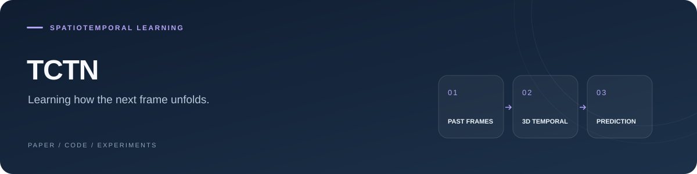

<p align="center">
  
</p>

### TCTN: A 3D-Temporal Convolutional Transformer Network for Spatiotemporal Predictive Learning

**Ziao Yang**, Xiangrui Yang, and Qifeng Lin

**[PDF](https://arxiv.org/pdf/2112.01085v1)** · **[Paper](https://arxiv.org/abs/2112.01085v1)** · **[Explore code](#explore-the-model)**

---

PyTorch implementation of TCTN for spatiotemporal predictive learning, combining 3D temporal convolution with Transformer-based modeling.

## Explore the model

| Component | Entry point |
| :--- | :--- |
| TCTN architecture | [`models/TCTN.py`](models/TCTN.py) |
| Network modules | [`TCTN_modules/`](TCTN_modules/) |
| Training and evaluation | [`run.py`](run.py) · [`trainer.py`](trainer.py) |
| Data loading | [`data_provider/`](data_provider/) |
| Metrics and preprocessing | [`utils/`](utils/) |

## Getting started

```bash
git clone https://github.com/yangziao56/TCTN-pytorch.git
cd TCTN-pytorch
```

Download the [Moving MNIST dataset](https://drive.google.com/drive/folders/1goWCEQoSWlcdmhV-UQffnNQLMa1FabeK?usp=sharing), then set the training and validation paths in [`run.py`](run.py). The entry point exposes options for sequence length, image size, model depth, and training settings.

For questions about applying TCTN to other datasets, contact [Ziao Yang](mailto:ziaoyang@brandeis.edu).

---

<details>
<summary><strong>Citation</strong></summary>

```bibtex
@misc{yang2021tctn,
  title = {TCTN: A 3D-Temporal Convolutional Transformer Network for Spatiotemporal Predictive Learning},
  author = {Yang, Ziao and Yang, Xiangrui and Lin, Qifeng},
  year = {2021},
  eprint = {2112.01085},
  archivePrefix = {arXiv},
  url = {https://arxiv.org/abs/2112.01085v1}
}
```

</details>
